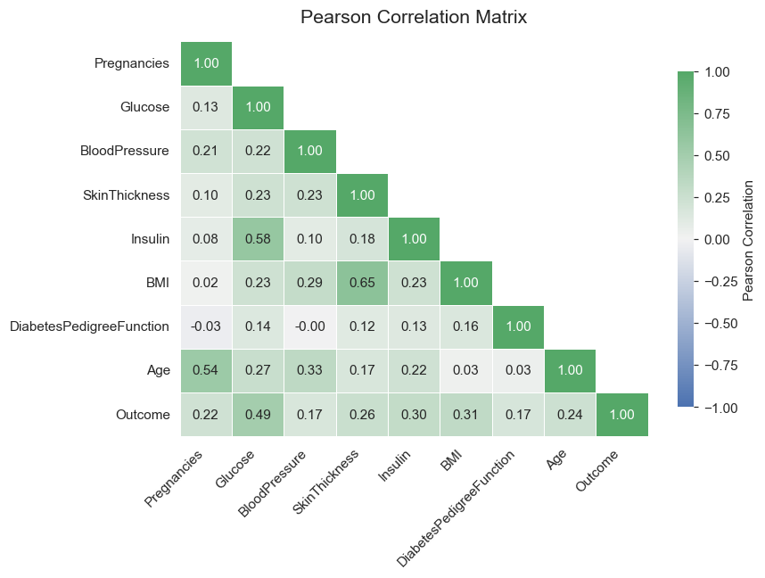
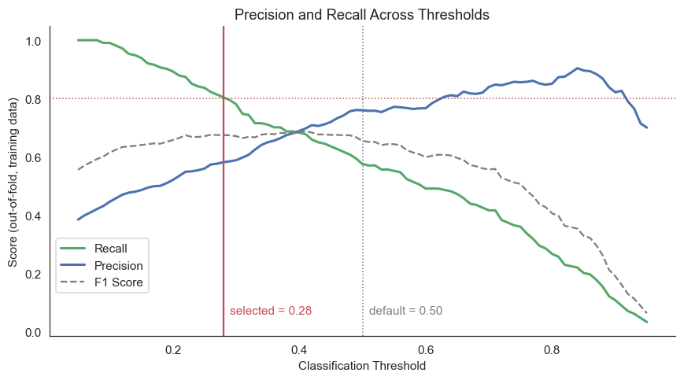
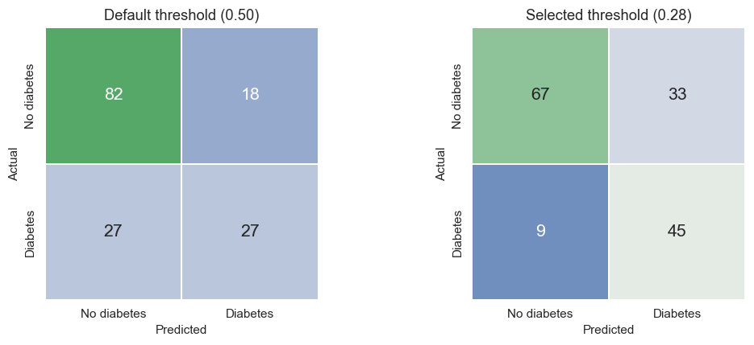
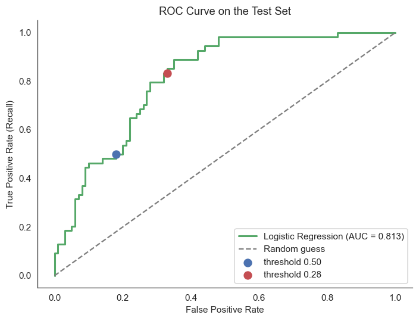

# Diabetes Prediction | Logistic Regression

I built this project to understand how much a simple, interpretable classifier can tell us about diabetes outcomes, and how much the **evaluation workflow** matters. Rather than chase a higher score with more algorithms, I focused on data quality, leakage-safe preprocessing, a defensible decision threshold, and honest reporting of uncertainty.

> **Scope:** This is an educational machine learning portfolio project, **not** a clinically validated diagnostic or screening tool.

## Results at a Glance

| Metric (held-out test set) | Default threshold (0.50) | Selected threshold (0.28) |
|---|---:|---:|
| Accuracy | 0.708 | 0.727 |
| Precision | 0.600 | 0.577 |
| Recall (sensitivity) | 0.500 | **0.833** |
| F1 score | 0.545 | **0.682** |
| ROC-AUC | 0.813 | 0.813 |

- **Training cross-validation:** mean ROC-AUC **0.843 ± 0.019** (mean ± standard deviation across five stratified folds; **not** a confidence interval).
- **Selected operating point:** the model identified **45 of 54** positive cases in the test set, with **33 false positives** among 100 negative cases.
- **Final model:** baseline Logistic Regression. GridSearchCV improved training-CV ROC-AUC by only about **0.001**, below my predefined minimum gain of 0.005.

Changing the threshold did **not** improve ROC-AUC or make the underlying model better at ranking cases. It changed the trade-off: higher recall, slightly lower precision, and more follow-up flags.

## Dataset and Data Quality

I used the [Pima Indians Diabetes Database](https://www.kaggle.com/datasets/uciml/pima-indians-diabetes-database): **768 records**, eight numerical predictors, and a binary `Outcome` target (0 = no diabetes, 1 = diabetes). The dataset documentation describes women aged 21 or older of Pima Indian heritage, which limits generalization to other populations.

There are no explicit missing cells in the original CSV, but zeros in `Glucose`, `BloodPressure`, `SkinThickness`, `Insulin`, and `BMI` are implausible measurements. I treated those zeros as missing-value markers. In particular, **48.7%** of `Insulin` and **29.6%** of `SkinThickness` values are zero. This treatment is a modeling assumption, not proof of why each measurement is absent.

I explored the cleaned data before modeling, but did not use full-dataset EDA to choose features or tune the model.

## How I Built the Model

1. **Split the data:** stratified 80/20 split with `random_state=42` (**614 train / 154 test**).
2. **Keep preprocessing inside one `Pipeline`:** `SimpleImputer(strategy="median")` → `StandardScaler()` → `LogisticRegression(max_iter=1000)`. Imputation and scaling are fitted anew inside each training fold, not on the test set.
3. **Evaluate the baseline:** stratified five-fold cross-validation on the training data.
4. **Check regularization:** `GridSearchCV` compares `C` values of 0.001, 0.01, 0.1, 1, 10, and 100 using ROC-AUC. The default L2 penalty is retained. The best setting (`C=0.1`) gains only about 0.001 ROC-AUC, so I keep the baseline (`C=1`).
5. **Choose the threshold on training data:** use `cross_val_predict` to obtain out-of-fold probabilities. Among thresholds with **at least 80% training-OOF recall**, choose the **highest** threshold to limit false alarms. This gives **0.28** (OOF recall **0.804**, OOF precision **0.581**).
6. **Evaluate the final model:** fit on the training set, then report performance at 0.50 and 0.28 on the held-out test set.

The 80% recall target is a **project assumption**, not a clinical standard. The OOF scores were used to select the threshold, so they are not an independent estimate of the entire selection procedure. This is **not** a fully nested evaluation of all modeling choices.

## Visual Analysis

All images below were exported **directly from the saved outputs of the final notebook** so the figures match the reported results.

### Correlation analysis



`Glucose` has the strongest correlation with `Outcome` (about 0.49). Some predictors are also correlated with each other, such as `BMI` and `SkinThickness` (about 0.65). The correlations use cleaned data and pairwise complete observations, so features with substantial missingness can have smaller effective sample sizes.

### Choosing the threshold



At the default 0.50 threshold, training-OOF recall is about 0.575. The selected 0.28 threshold reaches about 0.804 on the same OOF predictions, just above the assumed 80% target. This does not guarantee the same recall on new data.

### Confusion matrices



At 0.28, the test confusion matrix is **TN = 67, FP = 33, FN = 9, TP = 45**. At 0.50, it is **TN = 82, FP = 18, FN = 27, TP = 27**. The blue–green shading represents **counts**, not whether a prediction is correct; both panels use the same color scale.

### ROC curve



Both threshold markers belong to the same fitted model. The test ROC-AUC is **0.813** regardless of the decision threshold.

### Additional notebook figures

- [Outcome distribution](images/outcome_distribution.png)
- [Feature distributions](images/feature_distributions.png)
- [Feature boxplots by outcome](images/feature_boxplots_by_outcome.png)
- [Standardized Logistic Regression coefficients](images/logistic_regression_coefficients.png)

## Interpreting the Results

`Glucose` and `BMI` have the largest positive standardized coefficients in the fitted model. For `Glucose`, the estimated odds ratio is about **3.26 per one-standard-deviation increase**, holding the other features constant. That describes **odds**, not probability, and does not establish causation.

At threshold 0.28, test **specificity is 0.67** (67 of 100 negative cases correctly classified), while **negative predictive value is about 0.88** (67 of 76 predicted negatives are truly negative). These are different quantities; the latter also depends on disease prevalence.

To put the test results in context, I calculated approximate 95% bootstrap percentile intervals using **2,000 resamples**, holding the fitted model and threshold fixed:

| Metric | Point estimate | Approx. 95% bootstrap interval |
|---|---:|---:|
| ROC-AUC | 0.813 | 0.740–0.873 |
| Recall | 0.833 | 0.730–0.929 |
| Precision | 0.577 | 0.468–0.684 |

These intervals describe sampling uncertainty **conditional on this fitted model and threshold**. They do not cover uncertainty from retraining, threshold selection, or a different patient population.

## Limitations and Next Steps

The dataset is small and drawn from a narrow population. Many `Insulin` and `SkinThickness` measurements are missing, and `StandardScaler` can be sensitive to outliers. The model's probabilities have **not** been calibrated. Also, although the current code selects the model and threshold without using the test set, I inspected this same test split in earlier versions of the project. The test result is therefore not completely independent of the project's full development history.

If I continued the project, I would test missingness indicators and robust scaling, compare a few alternative models under the same cross-validation setup, evaluate probability calibration, and seek a genuinely **external dataset** for validation before considering any real-world use.

## Repository Structure

```text
Diabetes_Prediction_Logistic_Regression/
├── data/
│   └── diabetes.csv
├── docs/
│   └── Logistic_Regression_Notes.md
├── images/
│   ├── outcome_distribution.png
│   ├── feature_distributions.png
│   ├── correlation_matrix.png
│   ├── feature_boxplots_by_outcome.png
│   ├── threshold_optimization.png
│   ├── confusion_matrix.png
│   ├── roc_curve.png
│   └── logistic_regression_coefficients.png
├── notebooks/
│   └── Diabetes_Prediction_Logistic_Regression.ipynb
├── README.md
├── requirements.txt
└── .gitignore
```

## Run the Notebook

From the repository root:

```bash
pip install -r requirements.txt
jupyter notebook notebooks/Diabetes_Prediction_Logistic_Regression.ipynb
```

Keep the CSV at `data/diabetes.csv`. The notebook also searches beside itself and in Kaggle input folders. On Kaggle, attach the dataset and run all cells from a fresh session.

For more on the modeling decisions and interview-ready explanations, see [Logistic Regression Notes](docs/Logistic_Regression_Notes.md).

## What I Learned

The most useful lesson was not that a lower threshold produced a larger recall number. It was that **preprocessing, model selection, and threshold choice must be separated from final evaluation**, and that every apparent improvement has a cost. For this exercise, I preferred finding more positive cases, but I also reported the false alarms and uncertainty rather than presenting recall in isolation.

**Project notebook:** [View on Kaggle](https://www.kaggle.com/code/anahitapouladi/diabetes-prediction-logistic-regression)  
**Dataset:** [Pima Indians Diabetes Database](https://www.kaggle.com/datasets/uciml/pima-indians-diabetes-database)
